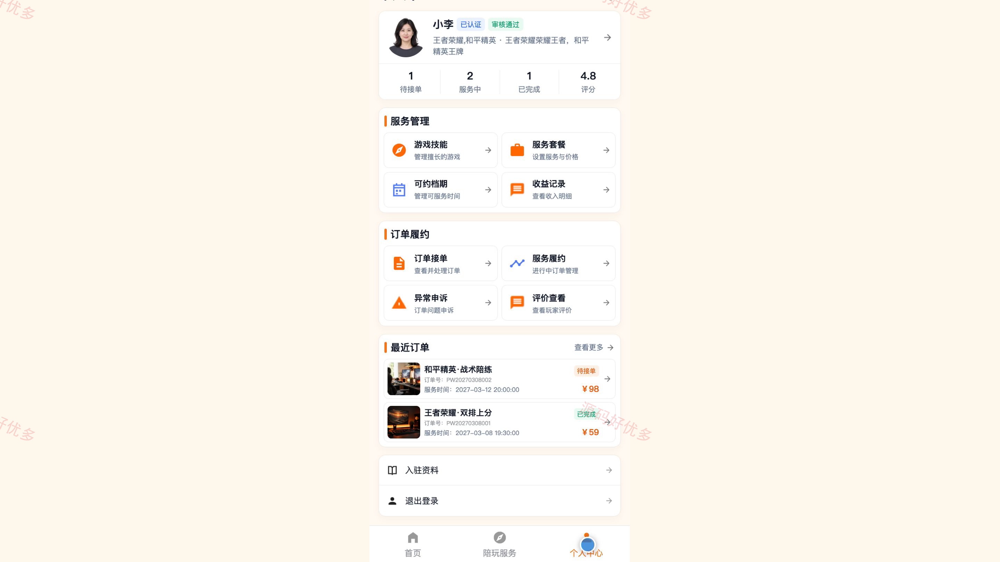
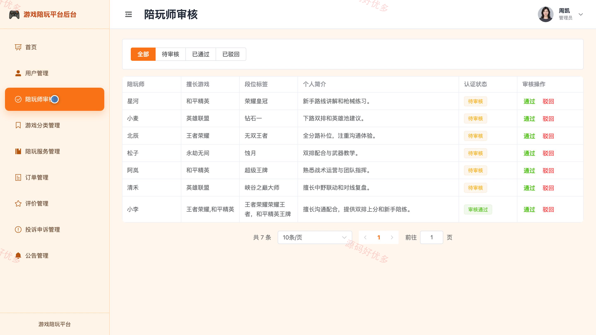
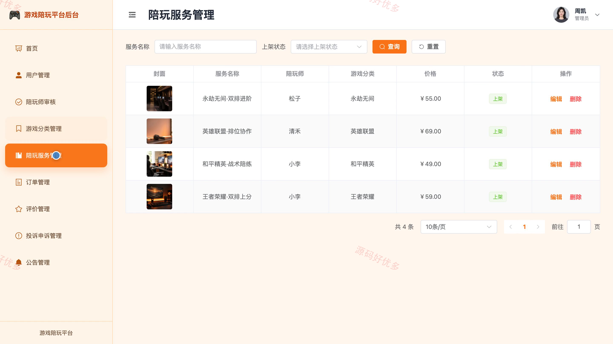

# bs100B
bs100B游戏陪玩小程序源码 Java SpringBoot3 Vue3 前后分离 设计文档
## 源码问题查看主页咨询

### 一、关键词
游戏陪玩、电竞陪练、在线约玩、陪玩预约、游戏服务

### 二、作品包含
源码+数据库+万字设计文档+PPT+全套环境和工具资源+本地部署教程

### 三、项目技术
前端技术： Html、Css、Js、Vue3.4、Element-Plus、uniapp
后端技术：Java、SpringBoot3.2.0、MyBatis-Plus

### 四、运行环境要求
开发工具：IDEA/eclipse + VSCODE + HBuilder X + 微信开发者工具

数据库：MySQL5.7（共11张表）

数据库管理工具：Navicat10以上版本

环境配置软件： JDK17 + Maven3.6

前端Nodejs：16+

浏览器：谷歌浏览器

### 五、项目介绍
项目编号：bs100B

本系统面向游戏陪玩服务场景，用户可浏览和筛选陪玩服务、收藏服务、预约下单并完成评价与投诉反馈；陪玩师可维护技能、档期和服务套餐，处理订单并查看收益；管理员在 PC 后台完成用户、陪玩师审核、游戏分类、服务、订单、评价、投诉申诉及公告维护。

角色：用户、陪玩师、管理员

用户功能：账号注册与登录、陪玩服务浏览与筛选、服务详情与收藏、预约下单、订单查看与取消、服务评价、投诉反馈、公告查看。

陪玩师功能：登录与入驻资料维护、游戏技能与档期维护、服务套餐管理、待接订单处理、服务履约更新、订单异常申诉、评价查看、收益统计。

管理员功能：数据统计、用户账号管理、陪玩师审核、游戏分类与服务管理、订单管理、评价内容管理、投诉申诉处理、公告管理。

### 六、运行截图

